

# B2B Studio

**Your Canon, shot like film. Baked in the camera.**

A film-camera interface and a film-look engine for Canons that run Magic Lantern. 
Shoot JPEG as usual; every picture is baked in the background with the film look you picked. 
Your Canon originals are never touched.

**English** · [Screens](#a-film-camera-inside-your-camera) · [Looks](#film-looks) · [Cameras](#cameras) · [Install](#putting-it-on-the-camera) · [Make your own](#make-and-share-your-own-looks) · [Build](#build-from-source)

 

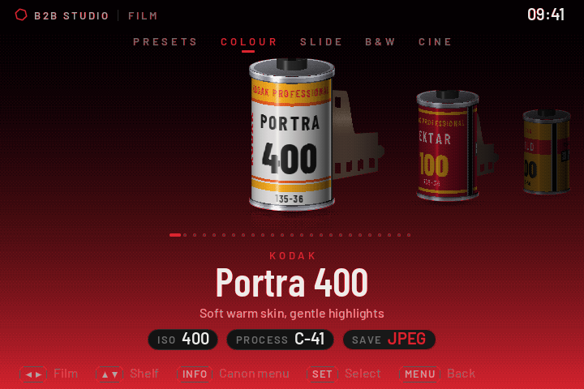

The film shelf. Every screenshot on this page is <b>SIMULATED</b>: a render of the camera's own screen drawing (720 × 480) made on a computer, not a photograph of a camera.

---

## A film camera, inside your camera

B2B Studio is a custom firmware layer for **Canon EOS cameras that already run [Magic Lantern](https://magiclantern.fm)**. It replaces the
camera's menus with a film camera drawn from scratch, and bakes a film look into every JPEG you shoot. It is built on
**[M-Film](https://github.com/HNGSeries/M-Film) by HNGSeries**, with a modern shooting screen, in-camera baking and a look system of its own.

<table>
<tr>
<td width="50%">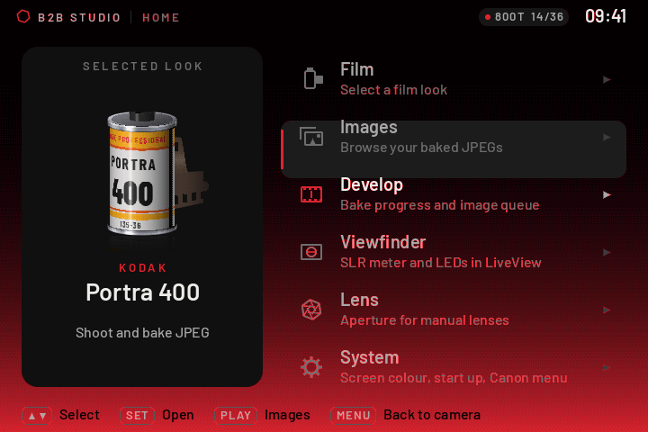</td>
<td width="50%">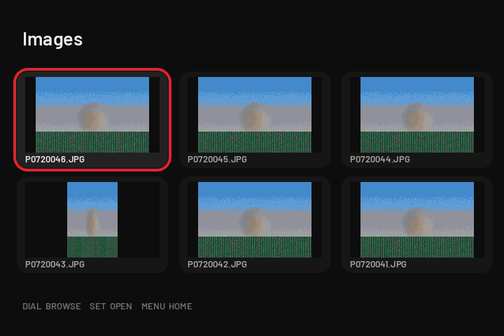</td>
</tr>
<tr>
<td><b>Home.</b> The look you picked on the left; Film, Images, Develop, Viewfinder, Lens and System on the right.</td>
<td><b>Images.</b> Your baked pictures, newest first, with the selected one outlined. A green tick means baked, a red disc means waiting.</td>
</tr>
<tr>
<td>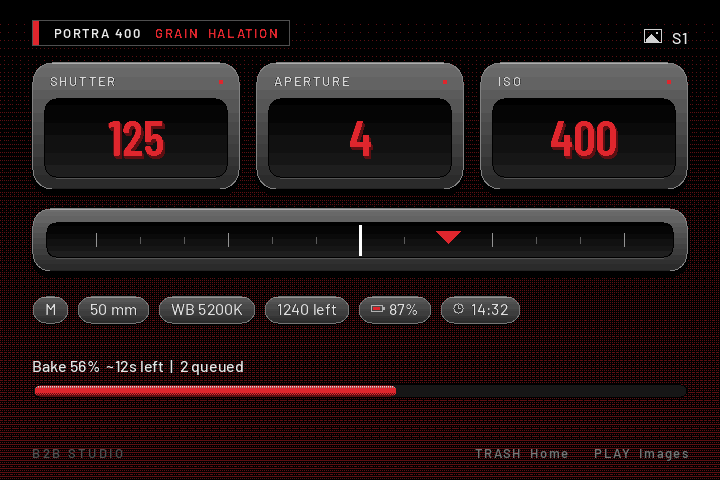</td>
<td>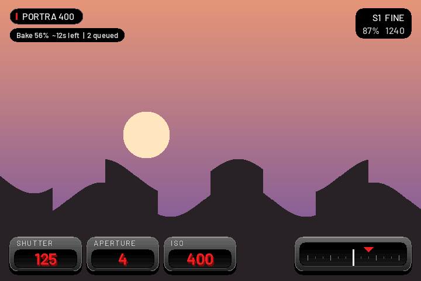</td>
</tr>
<tr>
<td><b>Shoot.</b> With LiveView off, raised cards for shutter, aperture and ISO, a light meter, camera details and the bake queue. The camera starts here.</td>
<td><b>LiveView.</b> The same cards, small, at the edges of the picture so it stays clear. The picture here is made up.</td>
</tr>
</table>

### Bake in the background

- Shoot **JPEG** (Large, Medium or Small). Each picture is run through a **3D colour table** (33³ LUT) and saved as a new file in the `PIXELJPG` folder.
- Your originals in `DCIM` are only ever read. If a bake fails, you still have the original.
- Shots queue up and are baked one at a time; a half-press pauses the bake. Large pictures are baked at Large.
- Optional **grain** and **halation** (a warm glow around bright lights) are baked into the file.
- The review after a shot is a quick preview, and fills in as the picture develops.

**Baking is slow on the camera's processor: tens of seconds per picture, and about four times longer for Large than Medium.** Speed numbers
on a real camera are in `ML/FILMROLL.LOG` (turn on *System > Debug log*).

### Colour themes

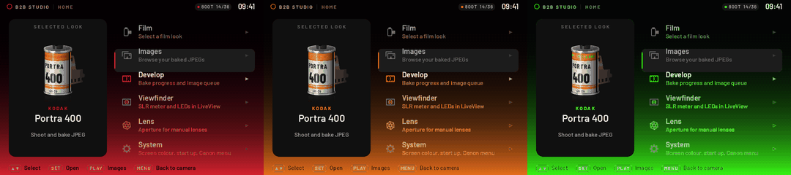

Red, orange or neon green across the menus and the shooting screen. A classic seven-segment style is under *Home > Viewfinder > Back screen style*.

<table>
<tr>
<td width="50%">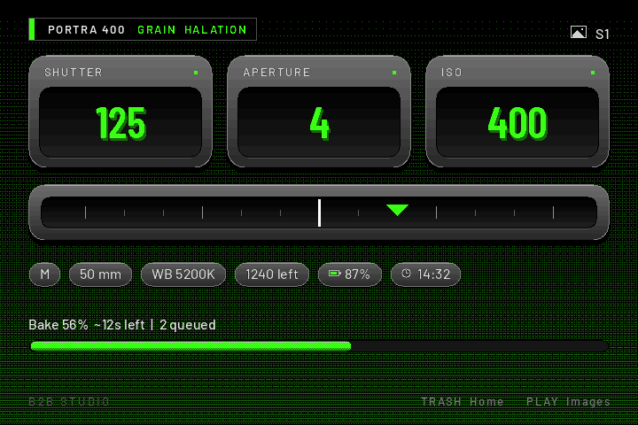</td>
<td width="50%">

**Controls on the 5D Mark III**

| Button | Does |
|---|---|
| TRASH | Home |
| PLAY | Images |
| M-Fn / button under the lens | Full-screen look list (joystick or dial, SET to go back) |
| Hold the button under the lens + main dial | Change the look |

Other cameras reuse these buttons where they exist; [tell us](#testing) which ones do something odd.

</td>
</tr>
</table>

---

## Film looks

**72 film looks** from the M-Film project, on shelves of colour negative, slide, black and white and cinema film, plus the **Cold Vibes** preset and a **FUJI X** shelf: Astia, Classic Chrome, Classic Neg., Provia and Reala Ace. Each has its own colour, grain and halation.

<table>
<tr>
<td width="33%">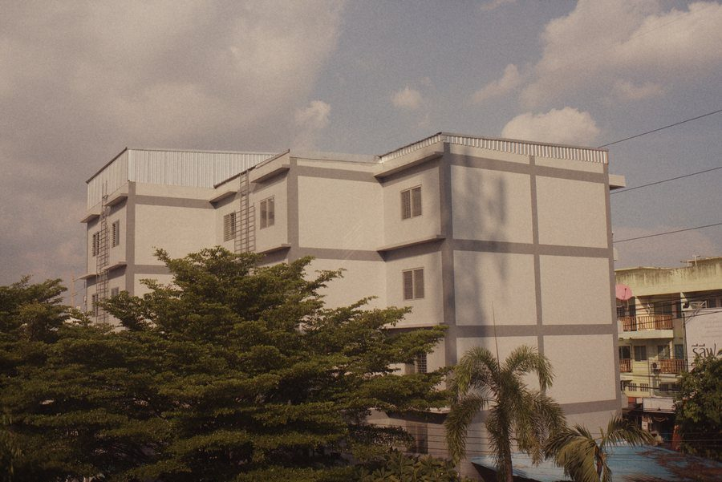 <b>Kodak Portra 400</b> Soft warm skin, gentle highlights</td>
<td width="33%">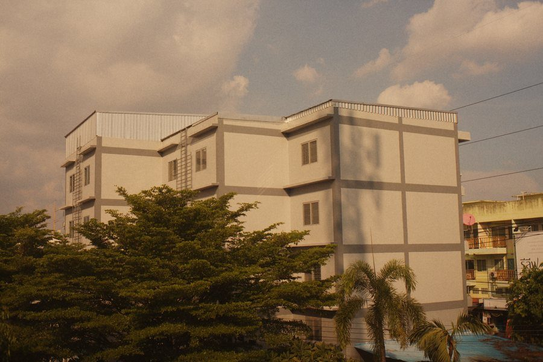 <b>Kodak Gold 200</b> Golden hour, all day long</td>
<td width="33%">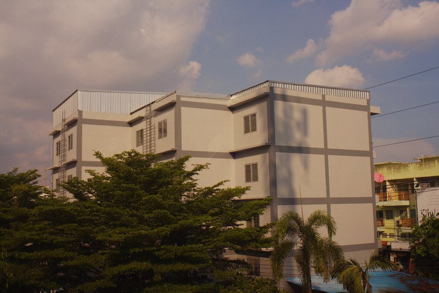 <b>Kodak Ektar 100</b> Punchy colour, ultra fine grain</td>
</tr>
<tr>
<td>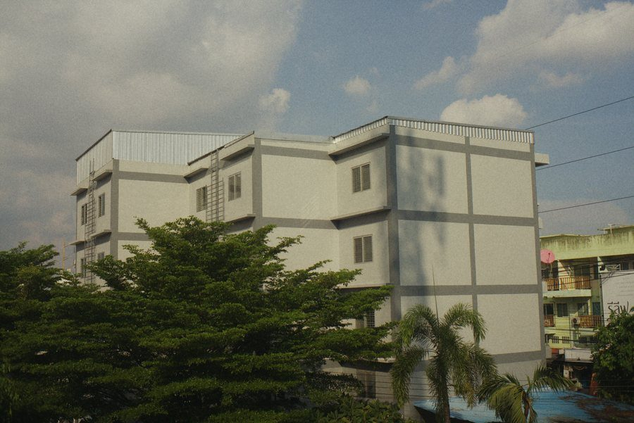 <b>Fujicolor Superia 400</b> Green shadows, everyday snaps</td>
<td>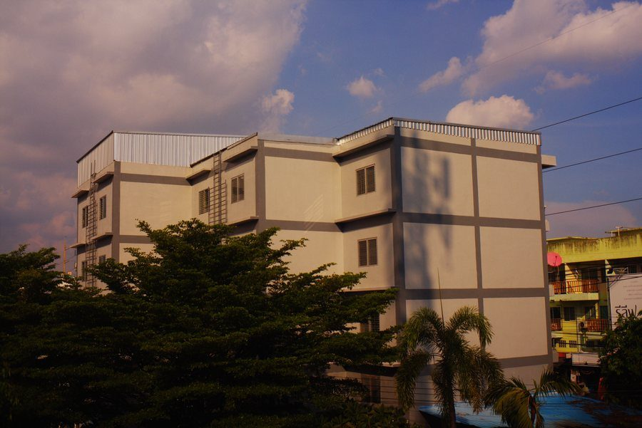 <b>Fujichrome Velvia 50</b> Vivid slide film, hard contrast</td>
<td>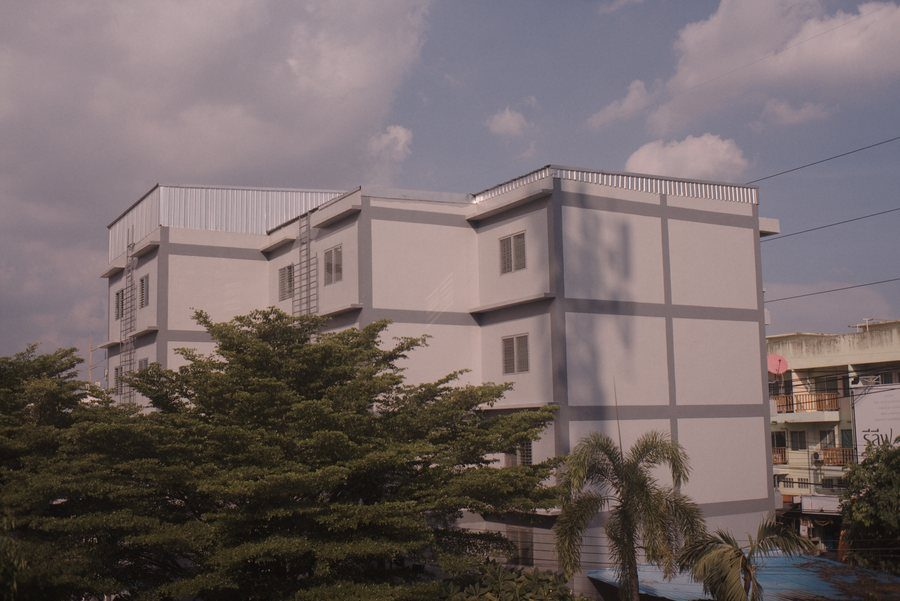 <b>Kodak Kodachrome 64</b> Magazine colour of the 70s</td>
</tr>
<tr>
<td>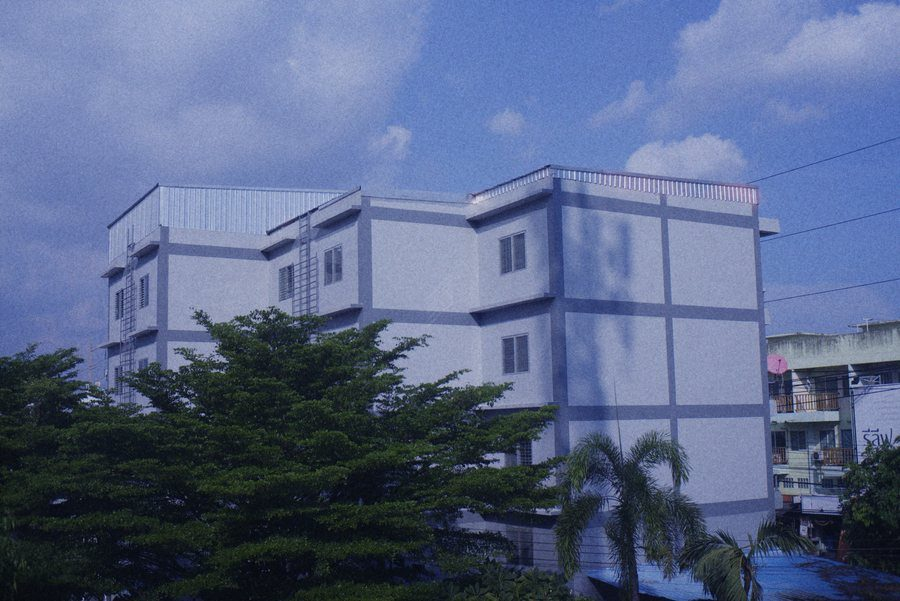 <b>CineStill 800T</b> Tungsten cine film, night goes blue</td>
<td>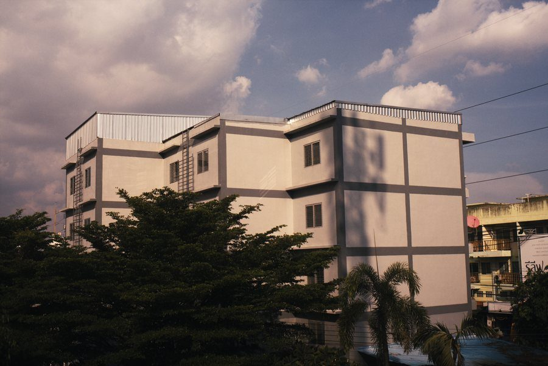 <b>Kodak Vision 2383</b> Cinema print: teal shadows</td>
<td>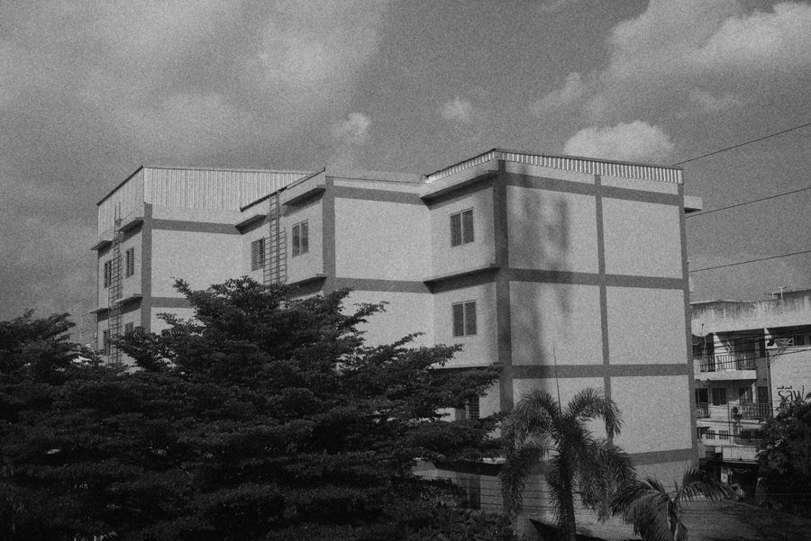 <b>Kodak Tri-X 400</b> Gritty contrast, street classic</td>
</tr>
</table>

**[All 72 films, on the same photo →](m-film/FILMS.md)** (rendered by M-Film from a Canon EOS M RAW; B2B Studio bakes the same colour tables into JPEGs.)

Colour for 63 of them comes from the [Film-Luts](https://github.com/YahiaAngelo/Film-Luts) collection; the rest from M-Film's own film models.

---

## Cameras

Each build is made for **one Canon model on one Canon firmware version**, and needs Magic Lantern already running on that camera.

| Camera | Canon firmware | Magic Lantern | Status | Download |
|---|---|---|---|---|
| Canon EOS 5D Mark III | 1.2.3 | 5D3.123 | ⚠️ **Beta.** Tried on one camera | `B2B-Studio-5D3.123-beta8.zip` ([release](../../releases/tag/v0.8.0-beta)) |
| Canon EOS 6D | 1.1.6 | 6D.116 | 🧪 Builds, **needs a tester** | [test release](../../releases/tag/v0.8.1-test-builds) |
| Canon EOS M | 2.0.2 | EOSM.202 | 🧪 Builds, **needs a tester** | [test release](../../releases/tag/v0.8.1-test-builds) |
| Canon EOS 700D / Rebel T5i | 1.1.5 | 700D.115 | 🧪 Builds, **needs a tester** | [test release](../../releases/tag/v0.8.1-test-builds) |
| Canon EOS 650D / Rebel T4i | 1.0.4 | 650D.104 | 🧪 Builds, **needs a tester** | [test release](../../releases/tag/v0.8.1-test-builds) |
| Canon EOS 100D / Rebel SL1 | 1.0.1 | 100D.101 | 🧪 Builds, **needs a tester** | [test release](../../releases/tag/v0.8.1-test-builds) |
| Canon EOS 70D | 1.1.2 | 70D.112 | 🧪 Builds, **needs a tester** | [test release](../../releases/tag/v0.8.1-test-builds) |

⚠️ tried on a camera, experimental · 🧪 builds and fits the camera's boot size limit where known; **nobody has run it on a camera yet**.
Any other camera or firmware version is not supported.

**Camera notes**

- **5D Mark III:** the only camera it has been run on. Joystick, M-Fn and the lens button all work.
- **6D, 700D, 650D, 100D, 70D:** a wheel and a Q button but no joystick (the 6D), or a touch screen and Q button (the others). Tell us which buttons do something odd.
- **EOS M:** everything happens in LiveView. The touch screen, SET, arrows, wheel, PLAY, MENU, INFO and a two-finger touch (Home) drive it.
- **700D, 650D, 100D:** boot size is untested on these cameras. If one hangs at power on, take the card out and tell us.

### Testing

A bad build can hang the camera at power on until you take the card out; the camera works normally without the card. If you have one of the 🧪 cameras and
Magic Lantern already runs on it, please try a test build and open a **[test report](../../issues/new?template=camera-test-report.md)**. The
[quick check on the site](https://basiciggy.com/cfw/) takes a few minutes. Turn on *System > Debug log* first and attach `ML/FILMROLL.LOG`.

---

## Putting it on the camera

1. The camera must run **exactly** the Canon firmware in the table (MENU → last settings tab → *Firmware ver.*) and Magic Lantern must already start from your card.
2. **Back up your card.**
3. Download the zip for your camera from the [Releases](../../releases) page.
4. With the camera off, copy `autoexec.bin` and the `ML` folder from the zip to the root of the card, replacing files with the same name. Do **not** run *Firmware Update* again.
5. Switch the camera on. With *Start screen* on (System page) the film shelf opens; otherwise press TRASH on the shooting screen for Home.
6. Pick a look (Film), then shoot. Open **Develop** to watch the bake queue and **Images** to see the results.

To go back, restore your card backup. If the camera does not start, take the battery and card out, then start it without the card. Full steps are in
`START-HERE.txt` inside the zip.

### Updating to a new version

Copy the new `autoexec.bin` and `ML` over the old ones on a card that already boots Magic Lantern. If anything misbehaves, start from a clean card:
copy your photos (`DCIM`, `PIXELJPG`) off, reinstall Magic Lantern, then copy the new files.

---

## Make and share your own looks

<table>
<tr>
<td width="50%"><b><a href="https://basiciggy.com/cfw/designer/">Preset Gallery / Creator</a></b> Turns a Lightroom preset, a <code>.cube</code> LUT or a few sliders into a new film roll for the shelf, with a live preview of the canister and the look, and exports the files to copy onto the card. It runs in your browser; nothing is uploaded.</td>
<td width="50%"><b>Share a look</b> Made a look you like? <a href="../../issues/new?template=share-a-look.md">Share it</a>, or <a href="../../issues/new?template=share-a-photo.md">send a photo</a> taken with one.</td>
</tr>
</table>

---

## What is new

- **Beta 8 and test builds round 3:** the **FUJI X** shelf is now really its own shelf after Presets (Astia, Classic Chrome, Classic Neg., Provia, Reala Ace). Beta 7 and round 2 had those five looks but showed them inside Presets, so their notes were wrong. The fonts and film catalogue also load when memory is tight (EOS M).
- **Earlier: beta 7 and test builds round 2:** the five Fuji X looks, inside Presets.
- **Beta 6:** a modern LiveView screen, the camera starts on the shooting screen, M-Fn or the button under the lens opens a full-screen look list, no flashes when leaving a menu, and halation and grain show in the review.

## What to expect

- **Slow bakes.** The camera's processor takes tens of seconds per picture; shots queue up and the camera stays usable.
- **Experimental.** One camera so far. Don't use it on a shoot you can't repeat.
- **JPEG only.** RAW files are left alone.
- **No logo splash**, and the Support QR under *Home > System > Support* still leads to the M-Film developer's tip page.

## Credits

**Built on [M-Film](https://github.com/HNGSeries/M-Film) by HNGSeries**: the film OS (canister shelf, Home, UI engine, darkroom, look system) is their work. Thank you.
Also: [Magic Lantern](https://magiclantern.fm) via [reticulatedpines/magiclantern_simplified](https://github.com/reticulatedpines/magiclantern_simplified) (GPL-2.0),
[Film-Luts](https://github.com/YahiaAngelo/Film-Luts) by Yahia Angelo (MIT), TJpgDec by ChaN, Barlow by Jeremy Tribby (SIL OFL 1.1).
Pinned bases: M-Film `faf9b5ef902fede56a9b9ab2c80cc13f54b07fdb`, Magic Lantern `ed3e7c0dfacfdeaf3349dee73edf9e3621217462`.
Notices: `m-film/THIRD_PARTY.md`, `m-film/LICENSE`, `resources/LICENSES/`.

## Build from source

On Linux with `gcc-arm-none-eabi` (and newlib), `build-essential`, `zip`, Python 3.10 with numpy, scipy, pillow, segno and docutils: `bash BUILD-MINIMAL.sh`.
The card files end up in `m-film/ml-dev/out/fork-5D3.123/` and in the zip the script writes.

## Licence

GPL-2.0, like M-Film and Magic Lantern ([`m-film/LICENSE`](m-film/LICENSE)). Film names are descriptive only and not affiliated with Kodak, Fujifilm, CineStill,
Ilford, Agfa or others; "Canon" and "EOS" are trademarks of Canon Inc. This project is not affiliated with Canon. Canon firmware is not included.
